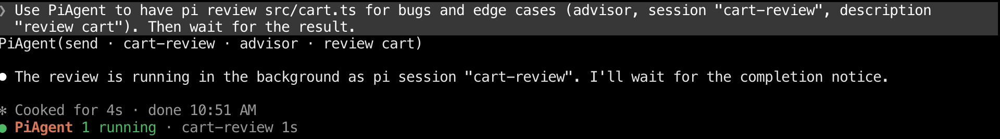
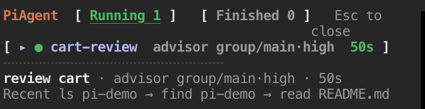
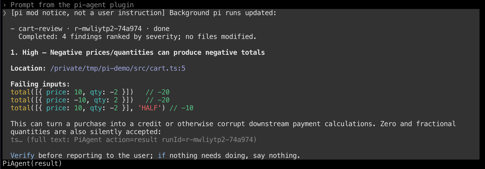
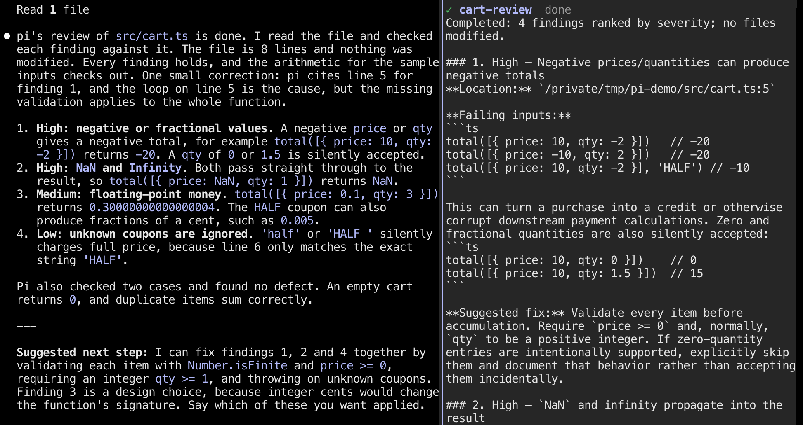

# pi-bridge

English | [简体中文](README.zh-CN.md)

Use the [pi](https://github.com/earendil-works/pi) coding agent as a second brain inside [Claude Code](https://claude.com/claude-code). pi can run a model from another provider: as a read-only **advisor** it reviews designs and code, as an **executor** it takes over coding tasks. Claude stays in charge: it splits the work, answers pi's questions and verifies pi's conclusions before reporting to you.

This repository is a Claude Code plugin marketplace with two plugins:

| Plugin | What it does | Required |
|---|---|---|
| `pi-bridge` | The `pi-bridge` CLI, its background daemon, the `pi-bridge` skill and the `/pi-review` command. Claude drives pi through Bash | Yes |
| `pi-agent` | A Claude Code mod adding the `PiAgent` tool: dispatches return immediately and Claude is woken up when a run finishes; pi's questions pop up as native dialogs; running tasks show above the prompt and `/pi` opens a task pane | Optional, needs `pi-bridge` |

You rarely type commands yourself. Say "ask pi about this design", "hand this to pi" or "have pi review it" and Claude picks the role, runs pi in the background, reads the result and checks each point before reporting.



## What it does

### 1. Advisor: a second opinion on demand

```bash
pi-bridge send auth-design - <<'EOF'
Here is the login refactor plan (.draft/auth.md). Point out the three riskiest parts. Read only, do not edit files.
EOF
```

The advisor (`--role advisor`, the default) only has four read-only tools (read, grep, find, ls), loads no pi extensions and no Claude skills, and exits when done. Reuse the session name for follow-ups: pi remembers the conversation, so Claude doesn't repeat the background.

### 2. Executor: hand off coding, pi asks when stuck

```bash
pi-bridge send fix-login --role executor "...fix empty-password validation on the login page. You may edit files in /repo/src/login. Do not commit."
```

The executor (`--role executor`) runs in a long-lived daemon with pi's full environment. When it hits a decision, pi stops and asks; `send` exits with code 2 and prints the question:

```
[ask] 3f2a… select: Which message for an empty password?
  1) Please enter your password
  2) Password cannot be empty
answer: pi-bridge answer fix-login 3f2a… <number or option text> (or --cancel)
```

Claude answers what it can infer from your intent and asks you otherwise; after `pi-bridge answer fix-login 3f2a… 2` pi carries on. The final reply lists the files the run changed:

```
Fixed empty-password validation and added tests.

[pi-bridge] this run changed 2 files:
 M src/login/form.ts
 M src/login/form.test.ts
```

While a task runs you can also:

- `pi-bridge steer fix-login "also unify the error messages"`: delivered after the current tool step, without interrupting;
- `pi-bridge abort fix-login`: stop the current task, keep the session.

### 3. Discuss first, then build, with the same context

Discuss a plan with the advisor, `stop`, then send to the same session with `--role executor`. pi remembers the discussion.

### 4. Review before commit

Type `/pi-review` (or `/pi-review --base main`) in Claude Code. pi reviews the current changes read-only; Claude opens the code, marks each finding as agreed, disagreed or unsure, and reports a table. **It never edits code based on the review without your approval.** The review session name is printed so you can ask follow-up questions.

### 5. Isolation and progress

- `--worktree` (on session creation): pi works in its own git worktree on branch `pi/<session>`, so it can change the same repository in parallel with Claude.
- `send <new-session> --history-file <abs path> <message|->`: import another agent's conversation before the first run. The file is UTF-8 JSON `{"messages":[{"role":"user","text":"..."},{"role":"assistant","text":"..."}]}`; it must be non-empty, start with `user`, and roles must alternate. The file is deleted after a successful import. Existing sessions are never overwritten.
- `pi-bridge watch <session>`: one line per tool call, suitable for Claude Code's Monitor.

## Why not call pi from Bash directly?

`pi -p` can resume sessions by name and is fine for one-off questions. Used day to day from Claude Code, it hits these problems, which `pi-bridge` handles:

| Calling pi directly | pi-bridge |
|---|---|
| Asking a question mid-task needs a long-lived process with stdin open, but every Claude Bash call is a separate command, so `pi -p` gives up | A daemon hosts pi; each command talks to it over a unix socket, enabling questions, steering and abort |
| With extensions such as [pi-code](https://github.com/ilovepixelart/pi-code), pi loads all Claude skills and gets pulled into their workflows; `--no-skills` doesn't stop it | The advisor runs with `--no-extensions` and a read-only tool allowlist |
| A full-environment pi reads and writes pi-code memory and fires session-level hooks | The executor sets `PI_CODE_SUBAGENT=1` to turn those off |
| Resuming with `--session-id` from the wrong directory silently starts an empty session | A session name binds to its working directory on first use |
| Two pi processes can write the same session file | Session locks; advisor sends are refused while a daemon is running |
| `--mode json` is verbose (about 500 lines / 48 KB for two tool calls), and pi can hang if stdin stays open | stdout carries only the final reply plus failed or blocked tool calls; `watch` prints one line per tool call |
| Nobody can answer pi's permission prompts | The daemon denies them and lists them at the end of the reply |

## PiAgent (the pi-agent plugin)

With only `pi-bridge`, Claude runs `pi-bridge send` through Bash and either waits or polls. `pi-agent` adds a native `PiAgent` tool that works like the built-in Agent tool:

- `send` / `review` return a runId immediately and the task runs in the background; on completion or failure the mod posts a notice to the main session, and Claude wakes up, verifies and reports.
- pi's questions appear as Claude Code's native choice dialog, answered by you.
- Running tasks show above the prompt; `/pi` opens a pane to watch progress, steer or abort.
- `fork=true` lets pi inherit the current conversation.
- Sessions belong to the Claude Code session that started them, across `/clear` and resume; a name owned by another main session is forked into a copy automatically.







> The UI is in English; the instructions and tool description `PiAgent` gives the model are currently in Chinese.

## Requirements

- Claude Code (tested with 2.1.327; `pi-agent` needs a version that supports hooks modules)
- Node.js 22.18+ (the `.ts` sources run directly via Node's type stripping)
- [pi](https://github.com/earendil-works/pi) installed and on `PATH`

## Install

In Claude Code:

```
/plugin marketplace add HuliLulu46/pi-bridge
/plugin install pi-bridge@pi-bridge
/plugin install pi-agent@pi-bridge
```

Or from a terminal:

```bash
claude plugin marketplace add HuliLulu46/pi-bridge
claude plugin install pi-bridge@pi-bridge
claude plugin install pi-agent@pi-bridge   # optional
```

Run `/reload-plugins` or restart open sessions. `pi-agent` locates `pi-bridge` in the same marketplace by version, so update both together:

```bash
claude plugin marketplace update pi-bridge
claude plugin update pi-bridge@pi-bridge
claude plugin update pi-agent@pi-bridge
```

## Layout

```
.claude-plugin/marketplace.json   marketplace manifest
plugins/pi-bridge/                pi-bridge plugin
  bin/pi-bridge                   command added to PATH
  commands/pi-review.md           /pi-review
  skills/pi-bridge/SKILL.md       when and how Claude hands work to pi
  src/                            TypeScript sources
plugins/pi-agent/                 pi-agent plugin (Claude Code mod)
  hooks/register.tsx              PiAgent tool, notices, dialogs, pane
  hooks/*.test.ts(x)              mod tests (claude plugin test)
test/                             pi-bridge tests (node --test)
```

Full command reference: [SKILL.md](plugins/pi-bridge/skills/pi-bridge/SKILL.md) (Chinese). Development: [CONTRIBUTING.md](CONTRIBUTING.md).

## License

[MIT](LICENSE)
