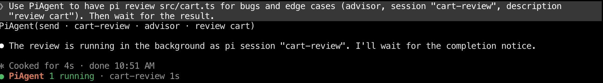
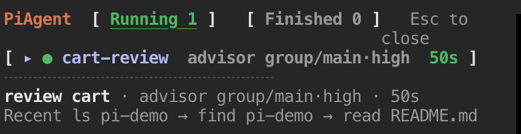
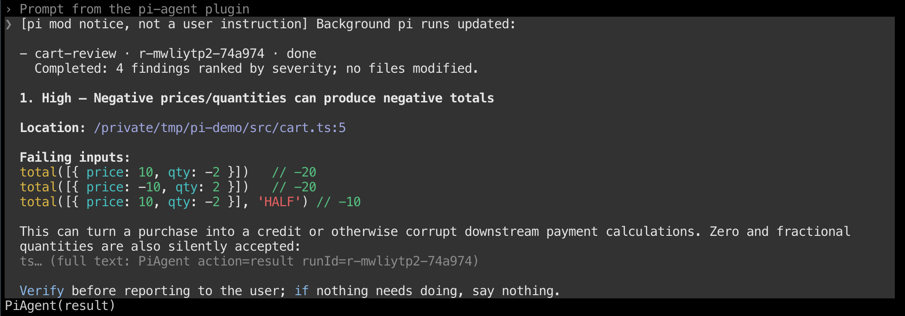
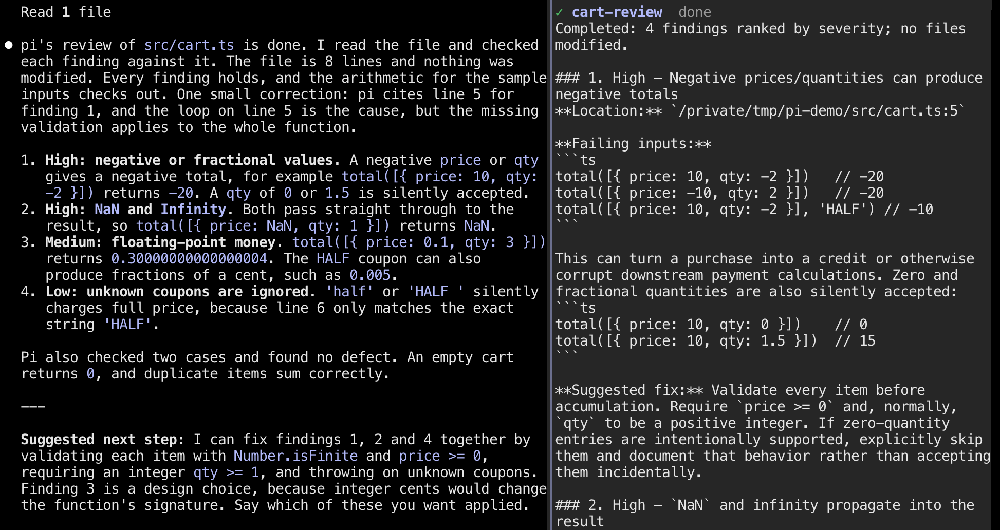

# pi-bridge

[English](README.md) | 简体中文

在 [Claude Code](https://claude.com/claude-code) 里把 [pi](https://github.com/earendil-works/pi) coding agent 当作第二个大脑来用。pi 可以背后跑另一家的模型：以只读顾问的身份给方案和代码提意见，或以执行者的身份接手编码任务。Claude 始终是主控，负责拆任务、回答 pi 的提问、核实 pi 的结论。

这个仓库是一个 Claude Code plugin marketplace，包含两个插件：

| 插件 | 做什么 | 是否必装 |
|---|---|---|
| `pi-bridge` | `pi-bridge` 命令行、常驻进程、`pi-bridge` skill 和 `/pi-review` 命令。Claude 通过 Bash 调用 pi | 必装 |
| `pi-agent` | 一个 Claude Code mod：提供 `PiAgent` 工具，派发后立即返回、完成时自动唤醒 Claude；pi 的提问弹出原生对话框；运行中的任务显示在输入框上方，`/pi` 打开任务面板 | 可选，依赖 `pi-bridge` |

日常使用不需要手敲命令。在 Claude Code 里说“问问 pi 这个方案”“交给 pi 改”“让 pi 评审一下”，Claude 会选好角色、在后台运行、读结果，并逐条核实后再汇报给你。



## 能做什么

### 1. 只读顾问：随时拿到第二意见

```bash
pi-bridge send auth-design - <<'EOF'
下面是登录模块改造方案（.draft/auth.md），请指出风险最高的三处，只读，不要改文件。
EOF
```

顾问（`--role advisor`，缺省角色）只有 read、grep、find、ls 四个只读工具，不加载 pi 的扩展和 Claude 的 skill，跑完即退出。同一个会话名可以多轮讨论，pi 记得前文，Claude 不必每次重复背景。

### 2. 执行者：把编码任务交出去，pi 卡住时会回头问

```bash
pi-bridge send fix-login --role executor "……修复登录页空密码的校验，授权修改 /repo/src/login 中的文件，不可以提交。"
```

执行者（`--role executor`）在常驻进程中运行，拥有 pi 的完整环境。任务进行到一半遇到需要拍板的地方，pi 会停下来提问，`send` 以退出码 2 结束并打印问题：

```
[ask] 3f2a… select: 空密码时的提示文案用哪一个？
  1) 请输入密码
  2) 密码不能为空
回答：pi-bridge answer fix-login 3f2a… <序号或选项原文>（或 --cancel 取消）
```

Claude 能根据你的意图回答的直接回答，拿不准的再问你；`pi-bridge answer fix-login 3f2a… 2` 之后 pi 接着干。任务完成时，回复末尾附上这次运行改动了哪些文件：

```
已修复空密码校验，并补充了对应测试。

[pi-bridge] 本次运行改动了 2 个文件：
 M src/login/form.ts
 M src/login/form.test.ts
```

任务进行中还可以：

- `pi-bridge steer fix-login "顺便把错误提示统一成中文"`：不打断任务，在当前这轮工具执行完后把补充指示送给 pi；
- `pi-bridge abort fix-login`：中止当前任务，会话保留，可以接着发消息。

### 3. 先讨论、再动手，上下文不断

同一个会话可以先以顾问身份讨论方案，`stop` 之后改用 `--role executor` 让 pi 按讨论结果动手。pi 记得之前的讨论，不需要把方案再讲一遍。

### 4. 提交前让 pi 评审

在 Claude Code 里输入 `/pi-review`（或 `/pi-review --base main`），pi 以只读方式评审当前改动，Claude 打开代码逐条核实，标注认同、不认同或待确认后用表格汇报，**不会未经你同意就按评审意见改代码**。评审结果末尾给出评审会话名，对某一条有疑问时可以接着追问。

### 5. 隔离运行与进度跟随

- `--worktree`：创建会话时加上，pi 在独立的 git worktree 和分支 `pi/<会话名>` 中工作，可以和 Claude 并行改同一个仓库，完成后整体验收再合并。
- `send <新会话名> --history-file <绝对路径> <消息|->`：首次运行前导入另一个 agent 的对话历史，支持 advisor、executor、`--detach` 和 `--worktree`。文件是 UTF-8 JSON：`{"messages":[{"role":"user","text":"之前的问题"},{"role":"assistant","text":"之前的回答"}]}`，`messages` 必须非空，每条 `role` 只能是 `user` 或 `assistant`，`text` 必须是字符串。调用方先合并连续同角色消息，并保证第一条为 user。本次消息仍可用 `-` 从 stdin 读取。导入成功后删除该文件，导入失败时保留。已有 bridge 记录、残留 pi 历史或属于其他 owner 的同名会话一律拒绝，不覆盖、不重复导入；不指定 `--model` 时使用默认模型。
- `pi-bridge watch <会话名>`：每次工具调用输出一行进度，可以交给 Claude Code 的 Monitor 实时跟随。

## 为什么不直接在 Bash 里调用 pi

`pi -p` 本身就能按会话名续接，直接调用适合一次性的简单问题。但在 Claude Code 里长期使用，会反复踩到下面这些问题，`pi-bridge` 把它们都处理掉了：

| 直接调用会遇到的问题 | pi-bridge 的处理 |
|---|---|
| pi 中途提问需要一个长期运行、标准输入一直开着的进程，而 Claude 每次调用 Bash 都是一条独立的命令，`pi -p` 遇到要提问的情况只能放弃 | 常驻进程托管 pi，Claude 的每条命令通过 unix socket 与它通信，所以能提问、插话、中止 |
| 装了 [pi-code](https://github.com/ilovepixelart/pi-code) 等扩展时，pi 会加载 Claude 的全部 skill，被 brainstorming、tdd 之类的流程带偏；`--no-skills` 关不掉这些 skill | 顾问用 `--no-extensions` 加只读工具白名单，彻底隔离，也保证只读 |
| 完整环境的 pi 会读写 pi-code 的记忆、触发会话级 hook | 执行者统一设置 `PI_CODE_SUBAGENT=1`，关掉这些副作用 |
| 在错误的目录下用 `--session-id` 续接，pi 只打一行警告就新建一个空会话，之前的上下文悄悄丢了 | 会话名首次使用时绑定工作目录，之后在哪里调用都回到同一个会话 |
| 两个 pi 进程可以同时写同一个会话文件 | 会话锁；常驻进程在运行时，拒绝以顾问身份发消息 |
| `--mode json` 的事件流很冗长，两次工具调用就有约 500 行、48 KB；在 Claude Code 的 Bash 里不关闭标准输入，pi 还可能一直卡住 | stdout 只输出最终回复，末尾附上出错或被拦截的工具调用；watch 每次工具调用只输出一行 |
| pi 要求权限确认时，没有人能回答 | 常驻进程一律拒绝并列在回复末尾，由 Claude 判断自己做还是转告你 |

这些规则写在 SKILL.md 里让 Claude 每次手动照做也行，但规则多、漏一条也不会报错；写成代码则每次都能做对。

## PiAgent（pi-agent 插件）

只装 `pi-bridge` 时，Claude 通过 Bash 运行 `pi-bridge send`，要么等它跑完，要么自己轮询。装上 `pi-agent` 后，Claude 多了一个原生工具 `PiAgent`，用法和内置的 Agent 工具一样：

- `send` / `review` 立即返回 runId，任务在后台运行；完成或失败时，mod 往主会话送一条通知，Claude 被唤醒后读结果、核实、汇报。
- pi 中途提问时，弹出 Claude Code 的原生选择对话框，由你直接回答。
- 运行中的任务显示在输入框上方；`/pi` 打开面板，可以查看进度、中止。
- `fork=true` 时 pi 继承当前对话的上下文，不必在消息里重复背景。
- 会话按 Claude Code 主会话归属：`/clear` 或恢复会话后仍认得自己派出的任务；别的主会话用了同名会话时，自动派到本会话的副本。



`/pi` 面板的按键：键盘焦点始终在列表里：`↑` / `↓` 在各行之间移动（到第一行、最后一行就停住），`Enter` 打开任务。按 `r`（Running）或 `f`（Finished）切换标签，标签名旁边会显示这两个字母。任务详情页里 `Esc` 回列表，`x` 中止运行中的任务，`1`–`4` 回答 pi 的提问；在列表页按 `Esc` 才关闭面板。Claude Code 不会把 `←` `→` 交给 mod，所以标签用字母切换。

Claude Code 不会把 `←` `→` 交给 mod。输入框为空时，面板里按 `←` 会漏给输入框，把当前会话转入后台并打开 agents 视图。想挡住的话，在 `~/.claude/keybindings.json` 的 `bindings` 数组里加一项，让面板吃掉这两个键：

```json
{ "context": "Pane", "bindings": { "left": "pane:top", "right": "pane:bottom" } }
```





> 界面文案是英文；`PiAgent` 注入给模型的说明和工具描述目前是中文。

## 运行要求

- Claude Code（2.1.327 测试通过；`pi-agent` 需要支持 hooks module 的版本）
- Node.js 22.18 或更高（直接运行 `.ts` 源码，依赖 Node 的类型擦除）
- 已安装 [pi](https://github.com/earendil-works/pi)，且 `pi` 在 PATH 中

## 安装

在 Claude Code 里执行：

```
/plugin marketplace add HuliLulu46/pi-bridge-for-claude
/plugin install pi-bridge@pi-bridge
/plugin install pi-agent@pi-bridge
```

或在终端里：

```bash
claude plugin marketplace add HuliLulu46/pi-bridge-for-claude
claude plugin install pi-bridge@pi-bridge
claude plugin install pi-agent@pi-bridge   # 可选
```

已打开的会话执行 `/reload-plugins` 或重启后生效。`pi-agent` 按版本目录查找同一 marketplace 里的 `pi-bridge`，两个插件请一起更新：

```bash
claude plugin marketplace update pi-bridge
claude plugin update pi-bridge@pi-bridge
claude plugin update pi-agent@pi-bridge
```

## 目录

```
.claude-plugin/marketplace.json   marketplace 清单
plugins/pi-bridge/                pi-bridge 插件
  bin/pi-bridge                   加入 PATH 的命令
  commands/pi-review.md           /pi-review 斜杠命令
  skills/pi-bridge/SKILL.md       指导 Claude 何时、如何把任务交给 pi
  src/                            TypeScript 源码
plugins/pi-agent/                 pi-agent 插件（Claude Code mod）
  hooks/register.tsx              PiAgent 工具、通知、对话框与面板
  hooks/*.test.ts(x)              mod 测试（claude plugin test）
test/                             pi-bridge 测试（node --test）
```

完整的命令说明与使用规则见 [SKILL.md](plugins/pi-bridge/skills/pi-bridge/SKILL.md)。参与开发见 [CONTRIBUTING.md](CONTRIBUTING.md)。

## 许可证

[MIT](LICENSE)
